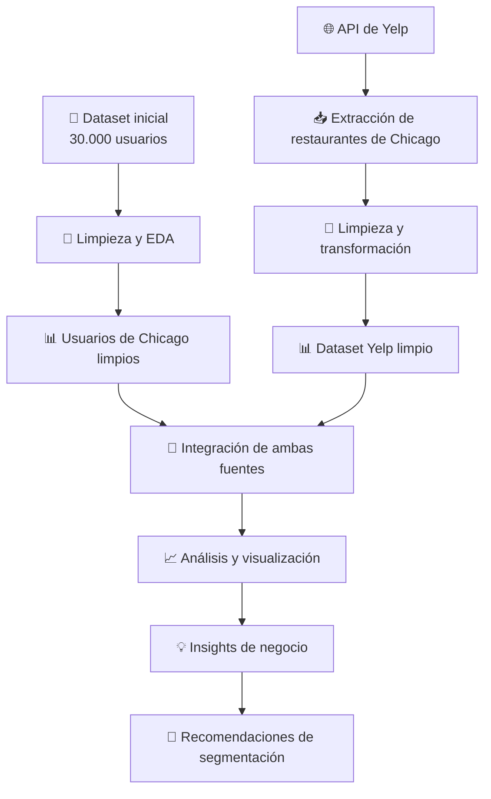

# 🍽️ Customer 360° Analytics

> **Integración de datos de usuarios y restaurantes, enriquecidos con la API de Yelp, para generar insights de negocio y recomendaciones de segmentación.**

<br>

<p align="center">

👥 **Usuarios:** 30.000 &nbsp;&nbsp;&nbsp;|&nbsp;&nbsp;&nbsp;
🌐 **Fuente externa:** API de Yelp &nbsp;&nbsp;&nbsp;|&nbsp;&nbsp;&nbsp;
📍 **Foco:** Chicago &nbsp;&nbsp;&nbsp;|&nbsp;&nbsp;&nbsp;
🍴 **Restaurantes analizados:** 200

</p>

<p>


</p>

---

# 📑 Tabla de contenidos

- [Descripción](#-descripción)
- [Objetivos](#-objetivos)
- [Estructura del repositorio](#-estructura-del-repositorio)
- [Cómo ejecutar](#-cómo-ejecutar)
- [Flujo de trabajo](#-flujo-de-trabajo)
- [Principales hallazgos](#-principales-hallazgos)
- [Recomendaciones de negocio](#-recomendaciones-de-negocio)
- [Competencias demostradas](#-competencias-demostradas)
- [Próximas mejoras](#-próximas-mejoras)
- [Autora](#-autora)

---

# 📌 Descripción

Este proyecto simula un desafío técnico para el rol de Data Scientist Jr. en una empresa ficticia de marketing analítico (**InsightReach**).

El objetivo consiste en integrar múltiples fuentes de datos para comprender el comportamiento de los clientes, enriquecer la información mediante la **API de Yelp** y generar recomendaciones estratégicas para optimizar campañas de marketing y segmentación comercial.

Durante el proyecto se aplicaron técnicas de limpieza, integración, análisis exploratorio de datos (EDA), consumo de APIs y comunicación de resultados.

---

# 🎯 Objetivos

- Analizar una base de usuarios con 30.000 registros.
- Limpiar y transformar los datos para mejorar su calidad.
- Integrar información de restaurantes reales obtenida desde la API de Yelp.
- Analizar patrones de consumo y preferencias alimenticias.
- Construir un algoritmo de recomendación personalizada de restaurantes.
- Elaborar recomendaciones estratégicas basadas en evidencia.

---

# 🗂 Estructura del repositorio

```
Customer-Insights-Yelp-API/
├── Avances/
│   ├── Avance_1/
│   │   ├── Avance_1_EDA_VC.ipynb                  # Limpieza y EDA de usuarios
│   │   └── base_datos_restaurantes_USA_v2.csv     # Dataset original (30.000 usuarios)
│   ├── Avance_2/
│   │   ├── Avance_2_API_VC.ipynb                  # Extracción y limpieza de datos de Yelp
│   │   └── Datos_YELP_limpios_VC.csv              # Restaurantes de Chicago (200)
│   └── Avance_3/
│       └── Avance_Analisis_Final_VC.ipynb         # Integración, recomendación y visualizaciones
├── Documentación/
│   ├── Informe_Tecnico.pdf                        # Informe técnico completo
│   └── Recomendaciones.pdf                        # Recomendaciones estratégicas
├── .env.example                                   # Plantilla de credenciales de Yelp
├── requirements.txt
└── README.md
```

---

# 🧪 Cómo ejecutar

```bash
git clone https://github.com/VaninaCavallin/Customer-Insights-Yelp-API.git
cd Customer-Insights-Yelp-API
pip install -r requirements.txt
jupyter notebook
```

Ejecutar los notebooks en orden:

1. **`Avances/Avance_1/Avance_1_EDA_VC.ipynb`**: genera `df_restaurante_limpio.csv` y `usuarios_restaurante_Chicago_limpio.csv`, que usa el Avance 3.
2. **`Avances/Avance_2/Avance_2_API_VC.ipynb`**: consulta la API de Yelp. Para correrlo hace falta una cuenta en [Yelp Fusion](https://www.yelp.com/developers): copiar `.env.example` como `.env` y completar las credenciales. El resultado ya está guardado en `Datos_YELP_limpios_VC.csv`, así que este paso es opcional.
3. **`Avances/Avance_3/Avance_Analisis_Final_VC.ipynb`**: integra ambas fuentes y genera el análisis final.

> 🔒 Las credenciales de la API se leen desde el archivo `.env`, que está excluido del repositorio.

---

# ⚙ Flujo de trabajo



## 1️⃣ Limpieza y exploración del dataset

Análisis exploratorio del dataset inicial para identificar inconsistencias, valores faltantes y registros fuera de rango: exploración de variables, limpieza, imputación de valores, corrección de inconsistencias y normalización.

**Resultado:** dataset limpio y dataset filtrado para Chicago.

## 2️⃣ Integración con la API de Yelp

Se consumió la API de Yelp para enriquecer el análisis con datos reales de restaurantes: categorías, rating, precio, ubicación y cantidad de reseñas. Luego se normalizó la respuesta JSON y se construyó un nuevo dataset limpio.

## 3️⃣ Integración, recomendación y análisis

Se combinaron ambas fuentes y se desarrolló un **algoritmo de recomendación personalizada** basado en la compatibilidad económica, las preferencias alimentarias y la calidad del restaurante. Además se analizaron el perfil demográfico, la distribución geográfica, la oferta gastronómica y la demanda potencial.

---

# 📊 Principales hallazgos

✔ Los usuarios premium presentan mayor gasto y frecuencia de visitas.

✔ Los usuarios jóvenes muestran preferencias por restaurantes fast casual.

✔ Existen zonas donde la demanda de restaurantes veganos supera la oferta.

✔ La integración de datos permitió identificar oportunidades para campañas de marketing segmentadas.

---

# 💼 Recomendaciones de negocio

- Segmentación por ingresos.
- Segmentación por edad.
- Segmentación por preferencias alimenticias.
- Campañas geolocalizadas.
- Programas de fidelización.
- Recomendaciones personalizadas.

El detalle se encuentra en [`Documentación/Recomendaciones.pdf`](Documentación/Recomendaciones.pdf) y el desarrollo completo en [`Documentación/Informe_Tecnico.pdf`](Documentación/Informe_Tecnico.pdf).

---

# 📈 Competencias demostradas

- Exploratory Data Analysis (EDA)
- Data Cleaning y Data Integration
- Consumo de APIs REST y manejo seguro de credenciales
- Normalización de datos JSON
- Feature Engineering
- Sistemas de recomendación basados en reglas
- Data Visualization
- Storytelling con datos y recomendaciones estratégicas

---

# 🚀 Próximas mejoras

- Dashboard interactivo con Power BI o Plotly.
- Modelos de segmentación mediante Clustering.
- Sistema de recomendación basado en Machine Learning.
- Modelos predictivos para gasto y frecuencia de visitas.

---

# 👩‍💻 Autora

**Vanina Cavallin**

Dra. en Ciencias Biológicas

Data Scientist | Data Analyst

💼 **LinkedIn:** https://linkedin.com/in/vanina-cavallin
